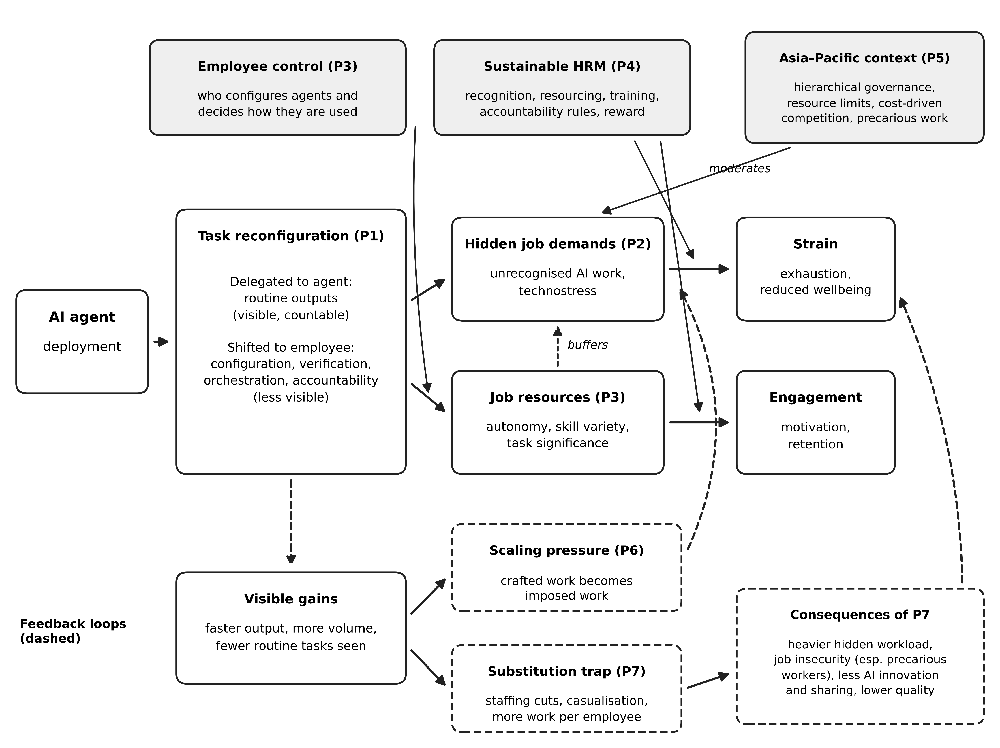

# Less work or more? Human–AI collaboration, invisible work and the substitution trap: A sustainable HRM framework for the Asia–Pacific

*Conceptual paper. Submission to the Asia Pacific Journal of Human Resources special issue "Human–AI Collaboration and Sustainable HRM in the Asia–Pacific". Anonymised for double-blind review.*

---

## Abstract

Generative AI agents are introduced into organisations on the promise that they will reduce employees' work, and managers under cost pressure may treat them as a reason to employ fewer people. This paper asks whether AI agents actually reduce the work of the employees who use them, and what happens when organisations assume they do. We argue that AI agents relocate rather than remove work: routine production moves to the agent, while configuring, verifying and answering for its output moves to the employee. Because the work that disappears is visible and the work that appears is not, organisations can misread AI adoption as freed capacity and cut or casualise staff. We call this the substitution trap. Integrating work design theory, the job demands–resources model, invisible work and sustainable human resource management (HRM), we develop seven propositions on when human–AI collaboration becomes a job resource or a hidden demand, how sustainable HRM moderates these outcomes, and how Asia–Pacific conditions raise the risk of the trap. The paper offers HR leaders a basis for assessing AI-related work before restructuring.

**Keywords:** human–AI collaboration; work design; invisible work; job demands–resources; job insecurity; sustainable HRM; generative AI; Asia–Pacific

---

## 1. Introduction

Generative AI has moved from experiment to everyday use in many organisations in a short time. Beyond general-purpose chatbots, organisations now deploy AI agents: systems that act on a user's or organisation's behalf, drafting responses to customers, producing reports, screening documents, writing code or giving feedback, often with limited human intervention for each output. The case for adopting them is usually framed in terms of time saved. If an agent drafts what an employee used to draft, the employee should have less to do.

This expectation has consequences for HRM. If AI saves employee time, the saving can be spent in two ways: on other, higher-value work, or on reducing labour costs through fewer positions, larger workloads per person or a shift to cheaper and less secure forms of employment. Estimates that a large share of occupations are at high risk of computerisation (Frey & Osborne, 2017) lend weight to the second option, and early field evidence of productivity gains from generative AI (Brynjolfsson et al., 2025) can be read as confirming it. For employees, the same technology that is presented as relieving their workload can become a signal that their jobs are at risk.

HRM research has begun to engage with these questions. A growing literature examines AI in HR functions such as recruitment, analytics and algorithmic management (Meijerink et al., 2021; Prikshat et al., 2023; Vrontis et al., 2022), and recent work considers how generative AI changes employees' jobs and HRM's strategic role (Budhwar et al., 2023; Chowdhury et al., 2024). Reviews call for research on how AI changes the content of work and employees' experience of it (Bankins et al., 2024). Yet one basic question remains under-theorised: when an employee works with an AI agent, does the employee's work actually decrease? And if the answer is less straightforward than it seems, what follows for staffing decisions that assume it does?

We address these questions with a conceptual paper. Our central argument is that AI agents do not automate work so much as **relocate** it. The visible, countable part of a job, the production of drafts, responses and routine outputs, moves to the agent. A less visible part, specifying what the agent should do, checking its outputs, coordinating it with other tools and people, handling its failures and answering for its results, moves to the employee. Because what disappears is easy to see and what appears is not, organisations can misread AI adoption as freed capacity. Acting on that misreading by reducing or casualising staffing removes the people whose hidden work keeps the agents useful and raises insecurity among those who remain. We call this the **substitution trap**.

We ask four questions:

1. Does working with AI agents reduce employees' work, or reconfigure it?
2. Under what conditions do the resulting changes act as job resources rather than job demands?
3. How do sustainable HRM practices and Asia–Pacific contextual conditions shape these outcomes?
4. What happens when organisations treat AI agents as a substitute for employees?

The Asia–Pacific offers a particularly important setting for these questions. The region combines highly digitalised economies with emerging ones, formal employment with large informal and precarious workforces, and HRM systems shaped by distinct institutional and cultural conditions (Budhwar et al., 2016; De Cieri et al., 2022). Research on AI and HRM has nonetheless been dominated by Western contexts, and the special issue to which this paper responds calls for theory that treats context as part of the explanation.

We build on four bodies of theory: work design theory, which treats job characteristics as the result of organisational and technological choices (Hackman & Oldham, 1976; Parker & Grote, 2022); the job demands–resources (JD-R) model, which explains how job characteristics lead to strain or engagement (Bakker & Demerouti, 2007, 2017); the concept of invisible work, which explains why some necessary work is not seen or rewarded (Star & Strauss, 1999); and sustainable HRM, which asks whether HR systems regenerate or deplete the human resources they depend on (Ehnert, 2009; Kramar, 2014).

Methodologically, the paper follows a model-building approach to conceptual research, in which established theories are combined to explain relationships among constructs and to derive testable propositions (Jaakkola, 2020). Consistent with criteria for theoretical contributions, we specify what the framework explains, how its constructs are related, why these relationships hold, and the conditions under which they apply (Whetten, 1989).

The paper makes four contributions. First, it extends the automation–augmentation debate (Raisch & Krakowski, 2021) from the level of tasks to the level of jobs, showing that augmentation of an output can coincide with intensification of the job that produces it. Second, it identifies AI configuration and oversight as a category of invisible work that HRM systems need to recognise. Third, it specifies Asia–Pacific conditions under which this work is more likely to be individualised and unresourced. Fourth, it explains how staffing decisions based on the visible effects of AI can undermine both employee wellbeing and the quality of AI-supported work, and identifies what sustainable HRM can do to prevent this.

## 2. Background

### 2.1 From AI tools to AI agents at work

Earlier workplace technologies, such as enterprise software or rule-based automation, were tools that employees operated. Generative AI agents differ in ways that matter for work design. They act with a degree of autonomy, deciding within limits set by their configuration what to produce and how. Their behaviour is shaped by natural-language instructions, examples and settings rather than conventional programming, which makes them accessible to employees without technical training. And several agents can be combined, each with a defined role, to handle a sequence of tasks.

Three properties of AI agents are central to the argument that follows. The first is **configurability**: their behaviour is not fixed by a vendor but shaped by whoever writes their instructions, which often places design responsibility close to the individual employee or team. The second is **fallibility**: generative models produce fluent output that can be wrong, so their use requires continuing verification rather than a one-off check. The third is **scale**: once deployed, an agent can produce output for many clients, cases or colleagues at once, so both its benefits and its errors multiply. Configurability creates design work, fallibility creates verification work, and scale magnifies the consequences of both. None of these properties is captured by the common image of AI as a tool that simply saves time.

### 2.2 AI in HRM research

HRM research on AI has concentrated mainly on AI used by organisations to manage people: in recruitment and selection, workforce analytics and algorithmic management (Meijerink et al., 2021; Prikshat et al., 2023; Vrontis et al., 2022). Reviews have mapped its antecedents, uses and consequences for HR functions (Malik et al., 2023) and for international HRM (Budhwar et al., 2022), and qualitative research in the region has examined how organisations experience AI adoption in HRM (Sithambaram & Tajudeen, 2023). Research on algorithmic management shows that AI can become a means of control over workers as much as a support for them (Kellogg et al., 2020).

The arrival of generative AI has turned attention to employees who work alongside AI in their own tasks (Budhwar et al., 2023; Chowdhury et al., 2024). Here the evidence is mixed. In a large customer-support operation, access to a generative AI assistant raised productivity, with the largest gains for less experienced workers (Brynjolfsson et al., 2025). In professional settings, by contrast, using AI for consequential judgements required additional effort to interpret and check its outputs (Lebovitz et al., 2022), and AI that took over core decisions unsettled employees' professional role identity (Strich et al., 2021). Evidence from education shows that the design of an AI system, such as whether it gives answers or guides the user to them, can determine whether it helps or harms the people it serves (Bastani et al., 2025). Survey research with academics similarly suggests that generative AI changes what professionals do rather than simply reducing it (Watermeyer et al., 2024).

Two gaps follow. First, most studies measure the output of human–AI collaboration, such as productivity or quality, rather than the composition and amount of work the human does to achieve it. Second, little research connects employees' experience of AI to the staffing decisions organisations make on the basis of expected AI savings. The framework developed here addresses both.

### 2.3 The automation–augmentation debate and its blind spot

The dominant management framing presents AI as either automating tasks, replacing human effort, or augmenting them, extending human capability, with augmentation usually seen as the more desirable path. Raisch and Krakowski (2021) argue that the two are interdependent over time: augmentation creates the knowledge that later enables automation, and automation creates new demands for human oversight. This insight is usually applied at the level of tasks or organisations. Applied at the level of the individual job, it suggests that when an employee hands a task to an AI agent, the job does not shrink by the size of that task. It changes shape. The employee stops producing some outputs and starts specifying, testing and supervising the system that produces them.

The blind spot is that these new tasks are rarely counted. Organisations measure what an agent produces, but not the effort required to keep it producing well. The result is a systematic gap between the work saved as the organisation sees it and the work saved as the employee experiences it. This gap is the starting point of our framework.

### 2.4 The Asia–Pacific context

HRM practices and their outcomes differ substantially across the Asia–Pacific, reflecting institutional, cultural and economic conditions (Budhwar et al., 2016; Cooke, 2018; De Cieri et al., 2022). Several features of the region are relevant to AI adoption. Many organisations operate in hierarchical governance structures with high power distance (Hofstede, 2001), in which change is more often directed from above and innovations from below are less often formalised. Many compete on cost, especially in emerging economies and in export-oriented and outsourced service sectors, which strengthens the incentive to translate technology into labour savings. Labour markets in parts of the region include large shares of fixed-term, agency, outsourced and informal workers with limited protection. And levels of digital infrastructure, skills and regulation vary widely, so that the resources available to support AI adoption differ greatly between and within countries. These features do not apply uniformly, and treating the region as homogeneous would repeat the error of treating Western findings as universal (Bartram & Cooke, 2022). They do, however, identify conditions under which the risks we describe are likely to be greater.

## 3. Theoretical foundations

### 3.1 Work design

Work design theory holds that the content and organisation of tasks, activities and responsibilities shape motivation, wellbeing and performance (Hackman & Oldham, 1976; Morgeson & Humphrey, 2006). Parker and Grote (2022) argue that digital technologies make work design more important, not less, because the same technology can enrich or impoverish jobs depending on how it is implemented. The sociotechnical tradition makes the same point: technical and social systems must be designed together, and changes in technology reorganise the social relations of work (Trist & Bamforth, 1951). For employees working with AI agents, the relevant characteristics include autonomy over how the agent is used, skill and task variety, task significance, feedback from the job and workload.

### 3.2 Job demands–resources

The JD-R model classifies job characteristics as demands, which require sustained effort and carry physiological and psychological costs, and resources, which help achieve goals, reduce demands or stimulate growth (Demerouti et al., 2001; Bakker & Demerouti, 2007). Demands drive a health-impairment process leading to strain and burnout; resources drive a motivational process leading to engagement. Resources also buffer the effect of demands, and employees can change their own demands and resources through job crafting (Bakker & Demerouti, 2017; Tims et al., 2012; Wrzesniewski & Dutton, 2001).

Technology-related demands have been studied as technostress: the strain that arises when technology increases work pace and volume, intrudes into personal time or requires constant updating of skills (Tarafdar et al., 2007). Technology can also generate positive stress when it is experienced as a challenge rather than a threat (Tarafdar et al., 2019). This distinction is important for AI-related work, which some employees find stimulating and others exhausting.

### 3.3 Invisible work

Star and Strauss (1999) describe work that is necessary but not seen, counted or rewarded, because it falls outside formal job descriptions or because its success makes it disappear. Configuring and maintaining AI agents fits this description closely. When an agent works well, others see only its output, and the effort that made it work is invisible. When it fails, the employee becomes visible as the person responsible. Invisibility is not a property of the work itself but of the way organisations define, measure and reward it, which makes it an HRM matter.

### 3.4 Sustainable HRM

Sustainable HRM extends strategic HRM by asking whether HR practices reproduce the human resources an organisation depends on, rather than simply extracting performance from them (Ehnert, 2009; Kramar, 2014). It draws attention to long-term effects on employee health, skills and willingness to stay, and to the tensions between short-term efficiency and long-term viability, which it treats as paradoxes to be managed rather than resolved (Ehnert, 2009). Applied to AI, it asks whether the gains from adoption are achieved by depleting employees, for example by relying on unrecognised effort or by cutting staff on the basis of expected savings, or by building their capacity.

### 3.5 Integrating the lenses

Each lens on its own explains part of the problem. Work design theory explains why the same AI deployment can enrich or impoverish a job, but says less about how the resulting job characteristics affect wellbeing over time. The JD-R model supplies that mechanism, but treats demands and resources as given rather than asking how they come to be defined and counted. The concept of invisible work fills this gap: whether a task is formally recognised determines whether it is allocated time, and therefore whether it replaces existing demands or adds to them. Sustainable HRM places these processes within the organisation's choices about how to use and reproduce its human resources, including its staffing decisions.

Combined, the lenses give a sequence. Technology deployment changes the task composition of jobs (work design). Some new tasks are recognised and some are not (invisible work). Unrecognised tasks act as additional demands, while recognised and self-directed ones can act as resources (JD-R). HRM practices determine which outcome dominates, and whether visible efficiency gains are converted into staffing cuts (sustainable HRM). Contextual conditions shape each step.

The integration also clarifies what the framework does not claim. It does not claim that AI agents are harmful to employees, nor that they are beneficial. It claims that their effect on work is indeterminate at the level of technology and determined by organisational choices that HRM can influence, consistent with the view that technology's effects on jobs are a matter of design rather than destiny (Parker & Grote, 2022).

## 4. A framework of human–AI collaboration, invisible work and the substitution trap

Figure 1 summarises the framework. Deploying AI agents reconfigures employees' tasks (P1). The reconfiguration creates new demands (P2) and new resources (P3), whose balance depends on employees' control over the agents. Sustainable HRM practices moderate how these demands and resources affect employees (P4). Asia–Pacific contextual conditions shape both the HRM response and the distribution of demands (P5). Visible gains feed back into organisational decisions about scaling (P6) and staffing (P7).

*Table 1. Key constructs*

| Construct | Definition used in this paper |
|---|---|
| AI agent | A generative AI system that produces outputs for users or clients with some autonomy, within limits set by its configuration |
| Delegated tasks | Tasks previously done by the employee that the agent now partly performs |
| AI configuration and oversight work | Tasks of specifying, instructing, testing, coordinating, monitoring and correcting agents, and answering for their outputs |
| Invisible work | Necessary work that is not formally described, measured or rewarded by the organisation (Star & Strauss, 1999) |
| Employee control | The extent to which employees decide whether and how agents are configured and used in their work |
| Substitution | Organisational decisions that reduce staffing, increase workload per employee or shift work to less secure employment on the basis of expected AI savings |
| Substitution trap | The cycle in which substitution based on visible savings intensifies hidden work, raises insecurity, reduces innovation and erodes the quality of AI-supported work |

### 4.1 Task reconfiguration

Deploying an AI agent changes the composition of the job. Tasks that involve producing routine outputs are partly delegated to the agent. New tasks appear: specifying the agent's role and limits; writing and revising its instructions; checking its outputs for accuracy and fit with organisational standards; coordinating several agents and their division of labour; monitoring use; handling exceptions and complaints; explaining the system to clients, colleagues and managers; managing cost, data protection and changes in the underlying model; and bearing accountability for outputs the employee did not produce. These tasks require a mix of domain, judgement and technical knowledge and are rarely described in job specifications.

*Table 2. Reconfiguration of work under AI agent deployment*

| Tasks partly delegated to agents (visible, countable) | Tasks created or expanded for employees (less visible) |
|---|---|
| Drafting routine documents, reports and messages | Specifying each agent's role, limits and standards |
| Responding to routine client or colleague queries | Writing, testing and revising agent instructions |
| Producing first-pass analyses, summaries and code | Checking outputs for accuracy, fairness and compliance |
| Generating variations of standard materials | Coordinating several agents and integrating their outputs |
| | Monitoring use and identifying failures or misuse |
| | Handling exceptions, complaints and disputed outputs |
| | Explaining the system to clients, colleagues and managers |
| | Managing cost, data protection and model updates |
| | Bearing accountability for outputs not personally produced |

The two columns are not equivalent in visibility. Tasks on the left are easy to count: numbers of documents, responses or cases handled. Tasks on the right are harder to count because they are iterative, irregular and often done outside scheduled time. The balance between the columns is also not fixed. Configuration work is front-loaded and may decline once an agent is stable, while verification and accountability continue. The net effect on workload may fall over time, but only if the task and the underlying model remain stable, which is rarely the case when providers update their models. The right-hand tasks also differ in kind: they are more judgement-intensive and carry more personal risk than the tasks they replace.

> **Proposition 1.** The deployment of AI agents reallocates employees' work from the direct production of routine outputs towards configuration, orchestration, verification and accountability tasks, rather than reducing total work by the amount of the delegated tasks.

### 4.2 Hidden demands

The new tasks carry demands that conventional workload measures are poorly placed to capture. Configuration is front-loaded and unpredictable; verification is continuous, because agent outputs can be wrong in ways that are hard to detect; and accountability is concentrated, because the employee is answerable for outputs they did not write. These demands resemble the techno-overload and techno-uncertainty components of technostress (Tarafdar et al., 2007). When the work is invisible, it is neither allocated time nor rewarded, and it becomes an additional demand on top of an unchanged formal workload.

> **Proposition 2.** The configuration, verification and accountability work created by AI agents constitutes a job demand that is positively related to employee strain, and this relationship is stronger when the work is not recognised in formal workload allocation and performance evaluation.

### 4.3 New resources and the role of control

The same reconfiguration can also add resources. Employees who configure agents gain autonomy over a new part of their work, use a wider range of skills, see their effort reach more people and receive rapid information about results. These are motivating job characteristics (Hackman & Oldham, 1976; Morgeson & Humphrey, 2006). Whether they operate as resources depends on control. When employees initiate and shape how agents are used, the change functions as job crafting (Tims et al., 2012; Wrzesniewski & Dutton, 2001), and demands are more likely to be experienced as challenges (Tarafdar et al., 2019).

When agents are imposed, standardised or monitored from above, the picture changes. Employees then keep the verification and accountability tasks in Table 2 but lose the configuration tasks that give them autonomy and meaning. The demands remain while the resources are removed, and the agent becomes closer to an instrument of algorithmic control than a tool of the employee (Kellogg et al., 2020). It may also erode professional role identity where the agent takes over judgements that employees regard as central to their work (Strich et al., 2021).

> **Proposition 3.** AI agent deployment increases job resources (autonomy, skill variety, task significance and feedback), and the positive relationship between deployment and work engagement is stronger when employees retain control over how agents are configured and used.

### 4.4 Sustainable HRM as a moderator

Sustainable HRM practices can determine whether AI-related work regenerates or depletes employees. Relevant practices include counting configuration and oversight work in workload and job design; providing time, tools and budget for it; offering training and peer support; setting governance rules that clarify responsibility for agent outputs; and recognising the work in performance evaluation, reward and career progression. These practices act as organisational resources that buffer the demands identified in P2 (Bakker & Demerouti, 2017) and signal that the organisation values long-term capability over short-term efficiency (Ehnert, 2009; Kramar, 2014).

Sustainable HRM is not free of tension here. Formalising AI configuration work makes it visible, but it can also make it auditable and standardised, reducing the autonomy that made it a resource. Consistent with a paradox perspective (Ehnert, 2009), the implication is to recognise the time and responsibility involved without prescribing in detail how the work is done, and to leave decisions about agents with the employees who answer for them.

> **Proposition 4.** Sustainable HRM practices that make AI configuration and oversight work visible and resourced weaken the relationship between that work and strain, and strengthen its relationship with engagement and retention.

### 4.5 Asia–Pacific contextual conditions

The conditions outlined in Section 2.4 affect different steps of the framework. Hierarchical governance affects recognition (P2 and P4): AI innovations initiated by employees are less likely to be formalised in workload, policy or reward when change is expected to come from above. Resource constraints affect the balance of demands and resources (P2 and P3): when organisations provide limited tools, training or budget, employees work around the limitations of cheaper systems, and verification and maintenance demands rise. Cost-driven competition affects the feedback loops (P6 and P7): where competitive advantage rests on labour cost, visible efficiency gains create strong pressure to scale AI and to convert savings into reduced staffing. Large precarious workforces affect who bears the consequences: where much routine work is done by fixed-term, agency or outsourced workers, the risks of substitution fall on those with the least protection and the least voice.

> **Proposition 5.** The relationship between AI agent deployment and unrecognised employee workload is stronger in organisations characterised by hierarchical governance, constrained resources and cost-driven competition, conditions common in parts of the Asia–Pacific.

### 4.6 The scaling loop

Successful AI initiatives generate visible signals, such as faster turnaround or higher output, that organisations can use to justify wider rollout. If scaling takes the form of an expectation that other employees adopt similar agents, or that those who built them support more teams, without corresponding resources, then a resource that was crafted voluntarily becomes an imposed demand. This is the point at which augmentation at the level of output becomes intensification at the level of the job.

> **Proposition 6.** Visible gains from AI agents increase organisational pressure to scale their use; when scaling is not accompanied by the HRM practices in Proposition 4, it converts AI configuration work from a crafted resource into an imposed demand.

### 4.7 The substitution trap

The final step concerns staffing. Organisations observe the visible part of the change: outputs produced without an employee producing them, and fewer routine tasks reaching staff. They do not observe the configuration, verification and accountability work described in P1 and P2. AI adoption therefore looks like freed capacity. Under cost pressure, this invites substitution: fewer positions, larger workloads per employee, non-renewal of fixed-term contracts, reduced use of agency or outsourced staff, or the expectation that a few skilled employees now support many teams.

Substitution based on this misreading has four consequences. First, it intensifies the work of those who remain, because the hidden work does not shrink when staff numbers do; it grows with the volume of output the agents serve. Second, it tends to fall first on the most precarious workers, whose tasks are most easily described as routine. Third, it raises job insecurity more broadly. Job insecurity is associated with lower wellbeing, weaker attitudes to work and withdrawal of discretionary effort (Shoss, 2017). Here it creates a perverse incentive: employees who are able to build effective AI agents may hesitate to do so, or to share what they have built, if visible success is likely to be used to justify cutting jobs. The organisation then loses the bottom-up innovation it benefited from. Fourth, substitution carries a quality risk. Evidence from other settings suggests that the value of AI systems depends on their design and on continuing human oversight (Bastani et al., 2025; Lebovitz et al., 2022). If the people who make those choices are removed or overloaded, the performance that justified the cuts is likely to deteriorate.

> **Proposition 7.** When organisations interpret AI agents as a substitute for employees and reduce or casualise staffing on that basis, (a) the workload and strain of remaining employees increase, (b) job insecurity increases, especially among precarious workers, (c) employees' willingness to develop and share AI innovations decreases, and (d) the quality of AI-supported work declines over time. These effects are weaker when staffing decisions are preceded by an assessment of the configuration and oversight work the agents require.

## 5. Discussion

### 5.1 Theoretical implications

For HRM research on AI, the framework shows that the level of analysis matters. At the level of output, AI agents augment work; at the level of the job, they can intensify it. Debates on automation and augmentation (Raisch & Krakowski, 2021) have focused mainly on the former. The framework brings the latter into view and connects it to established theories of work design and job demands and resources.

For work design theory, the framework adds AI configuration and oversight as a distinct cluster of tasks with its own demands and resources. This cluster is likely to grow as organisations configure agents rather than buy finished systems, and it applies across sectors wherever employees tailor AI to their work.

For sustainable HRM, the framework identifies invisibility as a mechanism through which AI adoption can deplete human resources. Sustainable HRM has emphasised long-term effects on health and skills (Ehnert, 2009; Kramar, 2014); our analysis suggests that whether new work is seen and counted is a precondition for any sustainable response, and that staffing decisions are where the consequences of invisibility become most serious.

For research on AI and employment, the substitution trap qualifies task-based predictions of labour displacement (Frey & Osborne, 2017). In knowledge work, tasks performed by AI are not simply removed from human jobs; they are partly replaced by new tasks of configuration and oversight that are harder to see. Staffing decisions that count only the removed tasks are likely to overestimate the labour saved.

For Asia–Pacific HRM, the framework specifies conditions under which the burden of AI adoption is likely to be individualised and transferred to precarious workers, adding to calls for research that treats context as an explanatory variable rather than a backdrop (Bartram & Cooke, 2022; Budhwar et al., 2023; Cooke, 2018).

### 5.2 Boundary conditions and alternative views

The framework applies most directly to knowledge and service work in which AI agents produce outputs that require judgement to evaluate. Where outputs are easily checked automatically, verification work will be smaller. It also applies most directly to agents that employees or teams configure themselves. Where organisations adopt finished systems with little scope for local configuration, configuration work shrinks but verification and accountability remain, and the autonomy-related resources in Proposition 3 are likely to be weaker.

One alternative view holds that the additional work is a transitional cost: as employees learn and tools mature, hidden work will shrink and real savings will appear. The framework does not rule this out, but suggests two reasons for caution. First, the models on which agents run change frequently and outside the organisation's control, so stabilisation may be partial. Second, even if savings appear later, staffing decisions taken earlier on the basis of expected savings will already have produced the effects described in Proposition 7. The sequence of decisions matters as much as the eventual balance of work.

A second alternative view is that employees who build AI agents do so voluntarily and enjoy it, so their extra work is not an HRM problem. Voluntary effort is indeed central to Proposition 3. But sustainable HRM is concerned precisely with whether organisations rely on effort they do not recognise or reproduce (Kramar, 2014). Voluntary innovation that becomes an organisational expectation, or the basis for staffing decisions, is no longer purely voluntary.

### 5.3 Practical implications

For HR leaders, the framework suggests six actions. First, make AI configuration and oversight work visible by including it in job design, workload planning and performance evaluation. Second, provide resources at the point of employee initiative: time, appropriate tools and budget, technical support and peer networks. Third, clarify accountability for agent outputs, so that employees are not personally exposed for errors in systems the organisation benefits from. Fourth, recognise AI-related skills and contributions in reward and career progression. Fifth, when scaling successful initiatives, scale the resources along with the expectations.

Sixth, and most important, do not treat AI adoption as evidence that staff can be reduced. Before any change to staffing levels, workloads or contract arrangements, assess the configuration, verification and accountability work the agents require, consult the employees who do it, and give particular attention to fixed-term, agency and outsourced workers. Making clear that successful AI innovation will not be used against those who produce it is a condition for continued innovation. In Asia–Pacific settings where hierarchical governance limits upward voice, HR functions have a particular responsibility to create channels through which employees can report the work AI creates.

Table 3 summarises these practices and the propositions they address.

*Table 3. Sustainable HRM practices and the propositions they address*

| HRM practice | Purpose | Propositions |
|---|---|---|
| Include AI configuration and oversight in job design and workload planning | Make hidden work visible and allocate time to it | P1, P2, P4 |
| Provide tools, budget, training and peer support | Reduce workarounds and build capability | P2, P4, P5 |
| Preserve employee discretion over how agents are configured | Keep AI work a resource rather than a control device | P3 |
| Clarify accountability for agent outputs | Reduce personal risk and uncertainty | P2, P4 |
| Recognise AI contributions in reward and careers | Signal that the work is valued | P3, P4 |
| Scale resources with expectations when rolling out | Prevent crafted work becoming imposed work | P6 |
| Conduct a work assessment before staffing changes; protect precarious workers; create voice channels | Avoid the substitution trap | P5, P7 |

### 5.4 Research agenda

The propositions can be tested in several ways. Time-use and diary studies could document how employees' tasks change after AI deployment, distinguishing delegated from created tasks (P1). Surveys could test the relationships between AI-related work, recognition, control, strain and engagement using validated JD-R, work design and technostress measures (P2–P4). Comparative studies across countries and sectors in the region could examine contextual conditions (P5), for example comparing organisations in highly digitalised and emerging economies. Longitudinal studies following AI initiatives from pilot to rollout could test the scaling loop (P6). Studies combining organisational staffing data with employee surveys on job insecurity and innovation behaviour could test the substitution trap (P7), ideally comparing organisations that did and did not adjust staffing after AI adoption. Multi-level designs would be especially valuable, since the framework links individual experiences to organisational decisions.

## 6. Limitations

This is a conceptual paper, and the propositions require empirical testing. The framework focuses on AI agents that produce outputs for others and on knowledge and service work; it does not address AI in manual or physical work, where configuration and verification may take different forms. It treats the Asia–Pacific through a set of general conditions rather than country-specific institutions, and the propositions will need to be adapted to particular national employment systems. Finally, the framework concentrates on employees who work directly with AI agents; the effects on colleagues, managers and clients deserve separate attention.

## 7. Conclusion

AI agents are often presented as a way to produce more with less human effort. Our answer to the question in the title is that, by themselves, they do not mean less work for employees: the work does not disappear but moves into configuration, verification and accountability tasks that organisations rarely see. The danger is that organisations treat the visible savings as real and the hidden work as non-existent, and reduce staffing accordingly. That would increase the burden on those who remain, fall hardest on precarious workers, discourage the innovation that made the tools useful, and weaken the quality of the work the tools were meant to improve. Treating AI-related work as work, and assessing it before making staffing decisions, is a first step towards human–AI collaboration that is sustainable for employees and organisations in the Asia–Pacific.

---

## Declarations

**Ethics statement.** Not applicable; this conceptual paper reports no empirical data.

**Data availability statement.** Data sharing is not applicable to this article as no new data were created or analysed.

**Conflict of interest statement.** [To be completed.]

**Funding statement.** [To be completed.]

**Author contributions (CRediT).** [To be completed.]

**Use of generative AI.** [To be completed in line with the journal's and Wiley's policy.]

---

## References

Bakker, A. B., & Demerouti, E. (2007). The Job Demands-Resources model: State of the art. *Journal of Managerial Psychology, 22*(3), 309–328. https://doi.org/10.1108/02683940710733115

Bakker, A. B., & Demerouti, E. (2017). Job demands–resources theory: Taking stock and looking forward. *Journal of Occupational Health Psychology, 22*(3), 273–285. https://doi.org/10.1037/ocp0000056

Bankins, S., Ocampo, A. C., Marrone, M., Restubog, S. L. D., & Woo, S. E. (2024). A multilevel review of artificial intelligence in organizations: Implications for organizational behavior research and practice. *Journal of Organizational Behavior, 45*(2), 159–182. https://doi.org/10.1002/job.2735

Bartram, T., & Cooke, F. L. (2022). Celebrating the 60th anniversary of the *Asia Pacific Journal of Human Resources*: What has been achieved and what more can be done. *Asia Pacific Journal of Human Resources, 60*(1), 3–21. https://doi.org/10.1111/1744-7941.12320

Bastani, H., Bastani, O., Sungu, A., Ge, H., Kabakcı, Ö., & Mariman, R. (2025). Generative AI without guardrails can harm learning: Evidence from high school mathematics. *Proceedings of the National Academy of Sciences, 122*(26), Article e2422633122. https://doi.org/10.1073/pnas.2422633122

Brynjolfsson, E., Li, D., & Raymond, L. (2025). Generative AI at work. *The Quarterly Journal of Economics, 140*(2), 889–942. https://doi.org/10.1093/qje/qjae044

Budhwar, P. S., Varma, A., & Patel, C. (2016). Convergence-divergence of HRM in the Asia-Pacific: Context-specific analysis and future research agenda. *Human Resource Management Review, 26*(4), 311–326. https://doi.org/10.1016/j.hrmr.2016.04.004

Budhwar, P., Chowdhury, S., Wood, G., Aguinis, H., Bamber, G. J., Beltran, J. R., Boselie, P., Lee Cooke, F., Decker, S., DeNisi, A., Dey, P. K., Guest, D., Knoblich, A. J., Malik, A., Paauwe, J., Papagiannidis, S., Patel, C., Pereira, V., Ren, S., . . . Varma, A. (2023). Human resource management in the age of generative artificial intelligence: Perspectives and research directions on ChatGPT. *Human Resource Management Journal, 33*(3), 606–659. https://doi.org/10.1111/1748-8583.12524

Budhwar, P., Malik, A., De Silva, M. T. T., & Thevisuthan, P. (2022). Artificial intelligence – challenges and opportunities for international HRM: A review and research agenda. *The International Journal of Human Resource Management, 33*(6), 1065–1097. https://doi.org/10.1080/09585192.2022.2035161

Chowdhury, S., Budhwar, P., & Wood, G. (2024). Generative artificial intelligence in business: Towards a strategic human resource management framework. *British Journal of Management, 35*(4), 1680–1691. https://doi.org/10.1111/1467-8551.12824

Cooke, F. L. (2018). Concepts, contexts, and mindsets: Putting human resource management research in perspectives. *Human Resource Management Journal, 28*(1), 1–13. https://doi.org/10.1111/1748-8583.12163

De Cieri, H., Sanders, K., & Lin, C. (V.) (2022). International and comparative human resource management: An Asia-Pacific perspective. *Asia Pacific Journal of Human Resources, 60*(1), 116–145. https://doi.org/10.1111/1744-7941.12309

Demerouti, E., Bakker, A. B., Nachreiner, F., & Schaufeli, W. B. (2001). The job demands-resources model of burnout. *Journal of Applied Psychology, 86*(3), 499–512. https://doi.org/10.1037/0021-9010.86.3.499

Ehnert, I. (2009). *Sustainable human resource management: A conceptual and exploratory analysis from a paradox perspective*. Physica-Verlag. https://doi.org/10.1007/978-3-7908-2188-8

Frey, C. B., & Osborne, M. A. (2017). The future of employment: How susceptible are jobs to computerisation? *Technological Forecasting and Social Change, 114*, 254–280. https://doi.org/10.1016/j.techfore.2016.08.019

Hackman, J. R., & Oldham, G. R. (1976). Motivation through the design of work: Test of a theory. *Organizational Behavior and Human Performance, 16*(2), 250–279. https://doi.org/10.1016/0030-5073(76)90016-7

Hofstede, G. (2001). *Culture's consequences: Comparing values, behaviors, institutions, and organizations across nations* (2nd ed.). Sage.

Jaakkola, E. (2020). Designing conceptual articles: Four approaches. *AMS Review, 10*(1–2), 18–26. https://doi.org/10.1007/s13162-020-00161-0

Kellogg, K. C., Valentine, M. A., & Christin, A. (2020). Algorithms at work: The new contested terrain of control. *Academy of Management Annals, 14*(1), 366–410. https://doi.org/10.5465/annals.2018.0174

Kramar, R. (2014). Beyond strategic human resource management: Is sustainable human resource management the next approach? *The International Journal of Human Resource Management, 25*(8), 1069–1089. https://doi.org/10.1080/09585192.2013.816863

Lebovitz, S., Lifshitz-Assaf, H., & Levina, N. (2022). To engage or not to engage with AI for critical judgments: How professionals deal with opacity when using AI for medical diagnosis. *Organization Science, 33*(1), 126–148. https://doi.org/10.1287/orsc.2021.1549

Malik, A., Budhwar, P., & Kazmi, B. A. (2023). Artificial intelligence (AI)-assisted HRM: Towards an extended strategic framework. *Human Resource Management Review, 33*(1), Article 100940. https://doi.org/10.1016/j.hrmr.2022.100940

Meijerink, J., Boons, M., Keegan, A., & Marler, J. (2021). Algorithmic human resource management: Synthesizing developments and cross-disciplinary insights on digital HRM. *The International Journal of Human Resource Management, 32*(12), 2545–2562. https://doi.org/10.1080/09585192.2021.1925326

Morgeson, F. P., & Humphrey, S. E. (2006). The Work Design Questionnaire (WDQ): Developing and validating a comprehensive measure for assessing job design and the nature of work. *Journal of Applied Psychology, 91*(6), 1321–1339. https://doi.org/10.1037/0021-9010.91.6.1321

Parker, S. K., & Grote, G. (2022). Automation, algorithms, and beyond: Why work design matters more than ever in a digital world. *Applied Psychology, 71*(4), 1171–1204. https://doi.org/10.1111/apps.12241

Prikshat, V., Malik, A., & Budhwar, P. (2023). AI-augmented HRM: Antecedents, assimilation and multilevel consequences. *Human Resource Management Review, 33*(1), Article 100860. https://doi.org/10.1016/j.hrmr.2021.100860

Raisch, S., & Krakowski, S. (2021). Artificial intelligence and management: The automation–augmentation paradox. *Academy of Management Review, 46*(1), 192–210. https://doi.org/10.5465/amr.2018.0072

Shoss, M. K. (2017). Job insecurity: An integrative review and agenda for future research. *Journal of Management, 43*(6), 1911–1939. https://doi.org/10.1177/0149206317691574

Sithambaram, R. A., & Tajudeen, F. P. (2023). Impact of artificial intelligence in human resource management: A qualitative study in the Malaysian context. *Asia Pacific Journal of Human Resources, 61*(4), 821–844. https://doi.org/10.1111/1744-7941.12356

Star, S. L., & Strauss, A. (1999). Layers of silence, arenas of voice: The ecology of visible and invisible work. *Computer Supported Cooperative Work, 8*(1–2), 9–30. https://doi.org/10.1023/A:1008651105359

Strich, F., Mayer, A.-S., & Fiedler, M. (2021). What do I do in a world of artificial intelligence? Investigating the impact of substitutive decision-making AI systems on employees' professional role identity. *Journal of the Association for Information Systems, 22*(2), 304–324. https://doi.org/10.17705/1jais.00663

Tarafdar, M., Cooper, C. L., & Stich, J.-F. (2019). The technostress trifecta – techno eustress, techno distress and design: Theoretical directions and an agenda for research. *Information Systems Journal, 29*(1), 6–42. https://doi.org/10.1111/isj.12169

Tarafdar, M., Tu, Q., Ragu-Nathan, B. S., & Ragu-Nathan, T. S. (2007). The impact of technostress on role stress and productivity. *Journal of Management Information Systems, 24*(1), 301–328. https://doi.org/10.2753/MIS0742-1222240109

Tims, M., Bakker, A. B., & Derks, D. (2012). Development and validation of the job crafting scale. *Journal of Vocational Behavior, 80*(1), 173–186. https://doi.org/10.1016/j.jvb.2011.05.009

Trist, E. L., & Bamforth, K. W. (1951). Some social and psychological consequences of the longwall method of coal-getting. *Human Relations, 4*(1), 3–38. https://doi.org/10.1177/001872675100400101

Vrontis, D., Christofi, M., Pereira, V., Tarba, S., Makrides, A., & Trichina, E. (2022). Artificial intelligence, robotics, advanced technologies and human resource management: A systematic review. *The International Journal of Human Resource Management, 33*(6), 1237–1266. https://doi.org/10.1080/09585192.2020.1871398

Watermeyer, R., Phipps, L., Lanclos, D., & Knight, C. (2024). Generative AI and the automating of academia. *Postdigital Science and Education, 6*(2), 446–466. https://doi.org/10.1007/s42438-023-00440-6

Whetten, D. A. (1989). What constitutes a theoretical contribution? *Academy of Management Review, 14*(4), 490–495. https://doi.org/10.5465/amr.1989.4308371

Wrzesniewski, A., & Dutton, J. E. (2001). Crafting a job: Revisioning employees as active crafters of their work. *Academy of Management Review, 26*(2), 179–201. https://doi.org/10.5465/amr.2001.4378011
